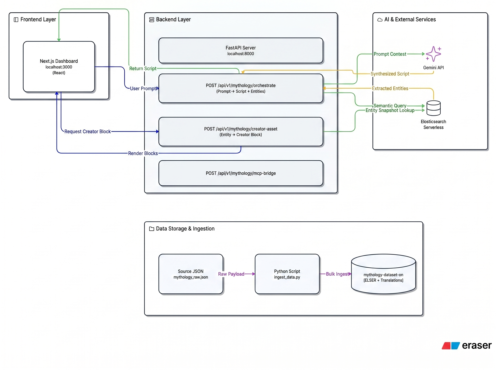

# MythosEcho

MythosEcho is a multilingual mythology content generator for creator workflows. It combines a Next.js dashboard, a FastAPI backend, Elastic Serverless semantic search, Elastic Agent Builder MCP, and Gemini synthesis to produce creator-ready hooks, narratives, and hashtag pills.

The app currently supports English and Hindi creator output. Tamil is wired through the UI/backend, but Tamil content requires `translations.ta.*` data to be ingested into Elastic before it can produce meaningful Tamil results.

### Quick Links
- Deployed Website: 
- Demo Video: 



## Current Capabilities

- **Multilingual Creator Dashboard** with language-specific content generation (English, Hindi, Tamil)
- **Two Backend Operating Modes:**
  - `Creator Flow`: Direct orchestration through FastAPI → Elasticsearch semantic search → Gemini synthesis → Multilingual creator asset generation
  - `Research Boost`: FastAPI bridge to Elastic Agent Builder MCP for advanced searches
- **Dedicated `/creator-asset` Endpoint** for fetching fully-translated mythology entities with native-language hooks, narratives, and metadata tags
- **Language-Aware Elasticsearch Queries** using translation fields:
  - `translations.hi.name` / `translations.hi.description` for Hindi
  - `translations.ta.name` / `translations.ta.description` for Tamil
  - Fallback to English with language script detection
- **ELSER Semantic Search** through `semantic_description` field (works across all languages)
- **No Hardcoded Translations** in Frontend — all translations come from Elasticsearch index
- **Creator-Ready Blocks** that render native language hooks, narratives, and SEO metadata tags without HTML templating
- **Single Multilingual Index Strategy:** `mythology-dataset-en` stores all language variants inline

## Getting Started

### Backend

```bash
cd backend
python -m venv .venv
.\.venv\Scripts\activate
pip install -r requirements.txt
cd app
uvicorn main:app --host 127.0.0.1 --port 8000 --reload
```

Health check:

```bash
curl http://127.0.0.1:8000/health
```

FastAPI docs:

```text
http://127.0.0.1:8000/docs
```

### Frontend

```bash
cd frontend
npm install
npm run dev
```

Open:

```text
http://localhost:3000
```

Build check:

```bash
npm run build
```

## Repository Layout

```text
backend/
  app/
    main.py                         FastAPI app, CORS, health check
    endpoints/mythology.py          /orchestrate, /mcp-bridge, /creator-asset routes
    services/elastic_mcp.py         Direct Elastic semantic + translation-aware queries
    services/gemini_agent.py        Gemini creator synthesis pipeline (now extracts entity_names)
  scripts/
    ingest_data.py                  Recreates and seeds mythology-dataset-en from raw JSON
    parser.py                       Normalizes source data into Elasticsearch documents
    mythology_raw.json              Primary seed dataset (5 deities, EN+HI translations)
    mythology_raw1.json             Extended dataset with Tamil translations included

frontend/
  src/app/page.tsx                  Main dashboard, API orchestration, entity translation fetching
  src/components/AssetGrid.tsx      Creator block rendering with native language content
  src/components/QueryForm.tsx      Language/platform selector UI

docs/
  ERASER_IO_PROMPT.md              Diagram prompt for eraser.io
  TAMIL_SETUP.md                   Tamil ingestion and setup guide
  diagram.jpeg                     Architecture diagram image file
```

## API Logic

### 1. `POST /api/v1/mythology/creator-asset` ⭐ NEW

Use this to fetch **fully-translated creator assets** directly from Elasticsearch with multilingual hooks and narratives.

Flow:

```text
Next.js UI
  -> POST /api/v1/mythology/creator-asset
  -> FastAPI CreatorAssetRequest
  -> Query mythology-dataset-en index
  -> Extract translations.{language}.name/description
  -> Generate creator hook + narrative in target language
  -> Return CreatorAsset with metadata tags
  -> Frontend displays native language content (no template mixing)
```

**Request:**
```json
{
  "entity_name": "Shiva",
  "target_language": "hi",
  "creator_platform": "YouTube"
}
```

**Response:**
```json
{
  "status": "success",
  "data": {
    "hook": "⚡ वायरल YouTube हुक: क्या आप जानते हैं कि हिंदू पौराणिक कथा के 'शिव' विनाश और योग के लिए प्रसिद्ध हैं?...",
    "narrative": "आज की कहानी 'शिव' की है। त्रिदेवों में विनाशक और परिवर्तनकारी। योग और साधना के स्वामी।...",
    "metadataTags": ["पौराणिककथा", "देवकथा", "शिव", "विनाश", "योग"],
    "language": "Hindi",
    "sourceSnippet": "...",
    "platform": "YouTube"
  },
  "source_entity": {
    "id": "mythos_hindu_shiva",
    "name": "शिव",
    "pantheon": "हिंदू पौराणिक कथा",
    "attributes": ["asceticism", "destruction", "meditation", "yoga"]
  }
}
```

This endpoint is now used by the frontend after orchestration to fetch proper multilingual translations for identified entities.

### 2. `POST /api/v1/mythology/orchestrate`

Use this when you want a full creator workflow synthesized by Gemini.

Flow:

```text
Next.js UI
  -> POST /api/v1/mythology/orchestrate
  -> FastAPI CreatorPayload
  -> query_elastic_mcp_context()
  -> Elastic index mythology-dataset-en
  -> semantic_description search + language field search
  -> Gemini synthesis (generates entity_names list)
  -> JSON response with script_segments, entity_names, and seo_metadata_tags
  -> Frontend fetches full translations via /creator-asset for each entity
  -> Display fully-translated creator blocks
```

Elastic query behavior (language-aware):

- **English:**
  - `name^2`
  - `description`
- **Hindi:**
  - `translations.hi.name^2`
  - `translations.hi.description`
- **Tamil:**
  - `translations.ta.name^2`
  - `translations.ta.description`
- **All languages also use:**
  - `semantic_description` with Elastic semantic search (ELSER)

### 3. `POST /api/v1/mythology/mcp-bridge`

Use this when you want to query Elastic Agent Builder MCP through your backend.

Flow:

```text
Next.js UI
  -> POST /api/v1/mythology/mcp-bridge
  -> FastAPI wraps simple UI body as JSON-RPC tools/call
  -> Adds secure Elastic ApiKey server-side
  -> POST ELASTIC_MCP_URL
  -> Elastic Agent Builder MCP
  -> FastAPI normalizes nested JSON/result/content/snippets
  -> frontend parses creator-ready localized blocks
```

This means:

- FastAPI successfully called Elastic MCP.
- The browser successfully called your local backend bridge.
- The frontend is not directly exposing the Elastic API key.

## Environment Variables

Create `backend/.env`:

```env
PROJECT_NAME="Mythos Echo Agent"
FRONTEND_URL="http://localhost:3000"

GEMINI_API_KEY="your-gemini-api-key"
GOOGLE_CLOUD_PROJECT="your-google-cloud-project"

ELASTIC_URL="https://your-elastic-es-endpoint:443"
ELASTIC_API_KEY="your-elastic-api-key"
ELASTIC_MCP_URL="https://your-kibana-endpoint/api/agent_builder/mcp"
```

For frontend local development, create `frontend/.env.local`:

```env
NEXT_PUBLIC_API_BASE_URL="http://localhost:8000"
```

For production frontend builds, set:

```env
NEXT_PUBLIC_API_BASE_URL="https://your-cloud-run-backend-url"
```

## Elastic Data Ingestion

### Seed Dataset

The main seed dataset is located at:

```text
backend/scripts/mythology_raw.json
```

### Adding New Languages

To expand the dataset with new languages (such as Tamil), please follow the comprehensive step-by-step guide in the [Tamil Setup Documentation](/docs/TAMIL_SETUP.md).

### Running Ingestion

```bash
cd backend
.\.venv\Scripts\activate
python scripts\ingest_data.py
```

**⚠️ Important:** `ingest_data.py` deletes and recreates `mythology-dataset-en`. Do not run it against production unless you intend to replace the index contents.

### Dataset Format

The seed JSON follows this structure:

```json
{
  "DeityName": "Shiva",
  "pantheon_group": "Hindu",
  "powers": "destruction, asceticism, yoga, meditation",
  "desc": "<p>The supreme destroyer and transformer...</p>",
  "translations": {
    "hi": {
      "name": "शिव",
      "description": "त्रिदेवों में विनाशक और परिवर्तनकारी।"
    },
    "ta": {
      "name": "சிவன்",
      "description": "முக்கடவுளிலே தொலிந்த அழிப்பான்..."
    }
  },
  "metadata": {
    "creator_notes": "Suited for stories involving transformation..."
  }
}
```

### Adding New Languages

To add translations for a new language (e.g., Spanish `es`):

1. Add to `mythology_raw.json`:
```json
"translations": {
  "hi": { "name": "...", "description": "..." },
  "ta": { "name": "...", "description": "..." },
  "es": { "name": "...", "description": "..." }
}
```

2. Re-run `ingest_data.py` to re-index

3. Update the `generate_creator_asset()` function in `backend/app/endpoints/mythology.py` to add Spanish templates:
```python
elif target_lang == "es":
    # Add Spanish creator asset generation
```

4. Query with `target_language="es"` in the API calls

## Google Cloud Run Deployment

### Backend Deployment

Deploy the FastAPI backend to Cloud Run and provide environment variables:

```bash
gcloud run deploy mythos-echo-backend ^
  --source backend ^
  --region us-central1 ^
  --allow-unauthenticated ^
  --set-env-vars FRONTEND_URL=https://your-frontend-domain ^
  --set-env-vars GEMINI_API_KEY=your-gemini-api-key ^
  --set-env-vars GOOGLE_CLOUD_PROJECT=your-google-cloud-project ^
  --set-env-vars ELASTIC_URL=https://your-elastic-es-endpoint:443 ^
  --set-env-vars ELASTIC_API_KEY=your-elastic-api-key ^
  --set-env-vars ELASTIC_MCP_URL=https://your-kibana-endpoint/api/agent_builder/mcp
```

After deployment, verify:

```bash
curl https://your-cloud-run-backend-url/health
```

### Frontend Production Build

Set the backend URL before building/deploying the frontend:

```env
NEXT_PUBLIC_API_BASE_URL="https://your-cloud-run-backend-url"
```

Then:

```bash
cd frontend
npm install
npm run build
npm run dev
```

If deploying the frontend separately, make sure the Cloud Run backend has:

```env
FRONTEND_URL="https://your-frontend-domain"
```

This keeps CORS locked to the deployed frontend.

## Troubleshooting

- If `mcp-bridge` returns 200 but content is empty, verify `ELASTIC_MCP_URL` and the Agent Builder tool name expected by the MCP server.
- If Hindi shows English tags, restart the Next.js dev server to clear stale `.next` chunks, then confirm the selected language is `hi`.
- If Tamil returns empty or English-like output, check whether the Elastic documents actually have `translations.ta.name` and `translations.ta.description`.
- If `orchestrate` falls back to mock content, confirm `ELASTIC_URL`, `ELASTIC_API_KEY`, and the `mythology-dataset-en` index exist.

## Troubleshooting

### Issue: Still seeing English text in Hindi/Tamil mode

**Solution 1: Verify backend is running**
```bash
curl http://localhost:8000/health
# Should return: {"status": "healthy", ...}
```

**Solution 2: Check browser console for fetch errors**
- Open DevTools (F12) → Console
- Look for failed `/creator-asset` requests
- Verify `NEXT_PUBLIC_API_BASE_URL` is correct in frontend

**Solution 3: Verify Elasticsearch index has translations**
```bash
# In Elastic Cloud Kibana DevTools:
GET mythology-dataset-en/_search
{
  "query": { "match": { "translations.hi.name": "शिव" } }
}
```

## License

This project is licensed under the MIT License. See [LICENSE](LICENSE) for details.
