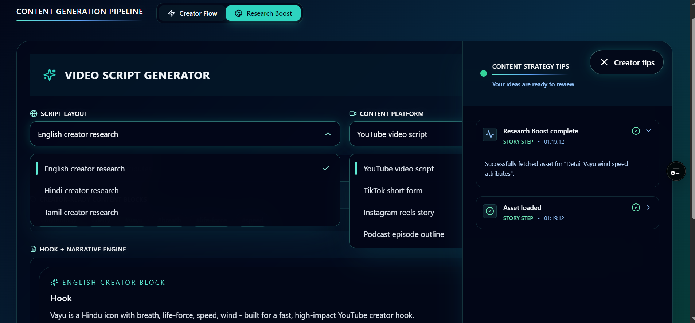
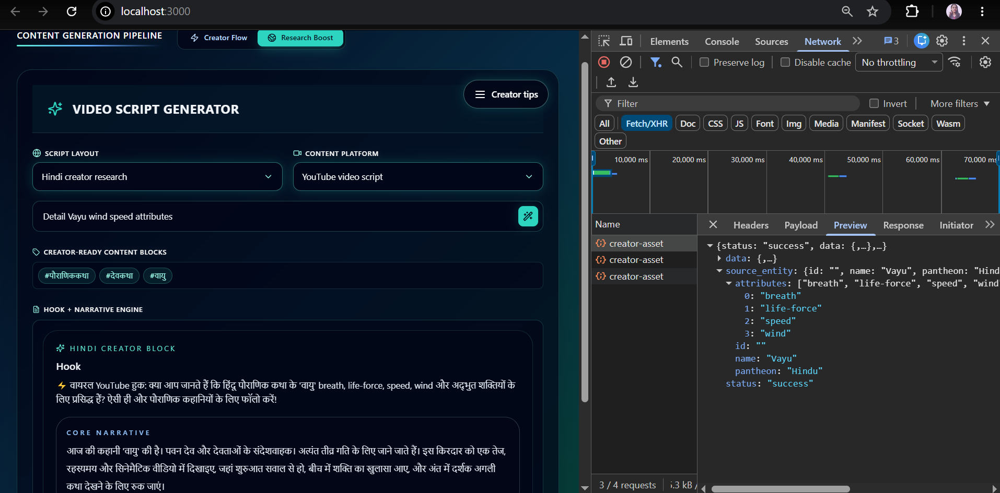
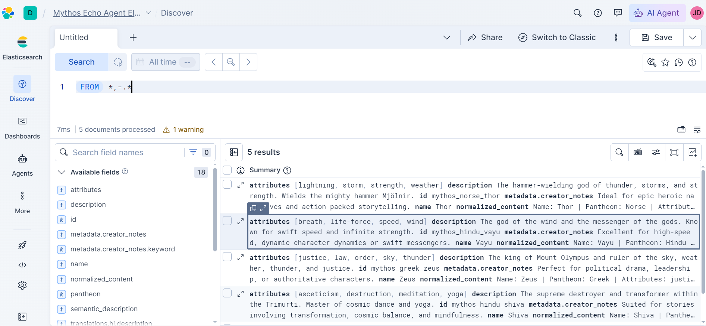
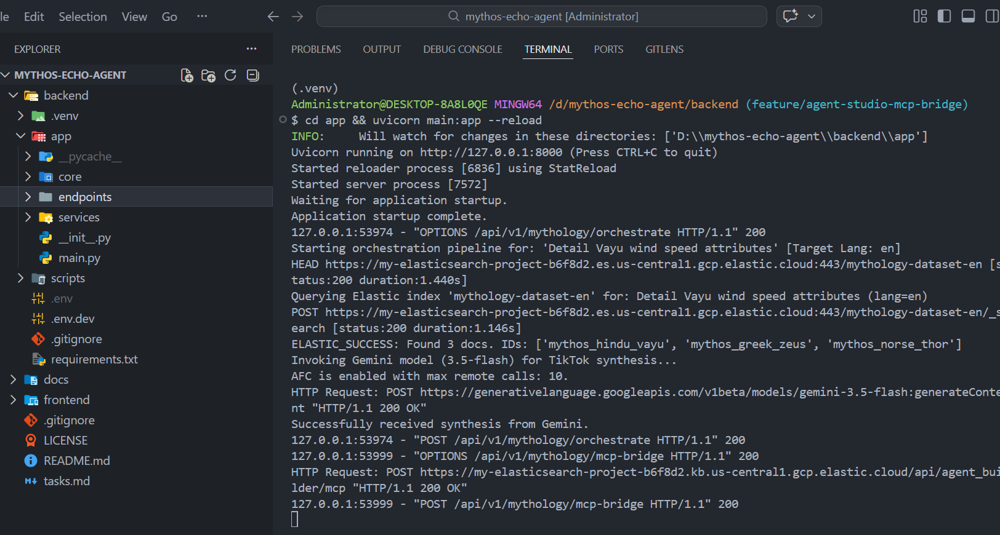
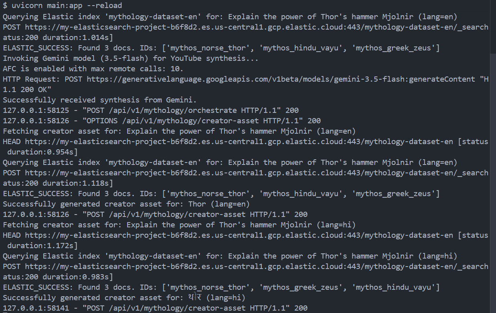

# MythosEcho

MythosEcho is a compact multilingual creator toolkit that synthesizes mythology-focused creator assets (hooks, narratives, metadata) using a Next.js dashboard, a FastAPI backend, Elastic Cloud Serverless (ELSER v2 embeddings + semantic search), and Vertex AI / Gemini for generation.

Quick, reliable, and language-aware, currently production-ready for English, Hindi and Tamil, to add other languages refer to the [Tamil Setup Documentation](/docs/TAMIL_SETUP.md).

---

## Quick Links

- Deployed Website: [CLICK HERE](https://mythos-echo-agent-jd.vercel.app/)
- Demo Video: [WATCH HERE](https://youtu.be/ceEnvTGIt8A)


---

## Architecture Flow (short)

Client UI (Next.js on Vercel)
→ Vercel (hosting)
→ Google Cloud Run (FastAPI backend)
→ Vertex AI / Gemini (generation)
→ Elastic Cloud Serverless (ELSER v2 embeddings & semantic index)

---

## Quick Start (local)

Backend:

```bash
cd backend
python -m venv .venv
source .venv\Scripts\activate
pip install -r requirements.txt
cd app
uvicorn main:app --host 127.0.0.1 --port 8000 --reload
```

Health check:

```bash
curl http://127.0.0.1:8000/health
```

Frontend:

```bash
cd frontend
npm install
npm run dev
```

Open: http://localhost:3000

---
## Environment Variables

Create `backend/.env`:

```env
PROJECT_NAME="Mythos Echo Agent"
FRONTEND_URL="http://localhost:3000"

GEMINI_API_KEY="your-gemini-api-key"
GOOGLE_CLOUD_PROJECT="your-google-cloud-project"

ELASTIC_URL="https://your-elastic-es-endpoint:443"
ELASTIC_API_KEY="your-elastic-api-key"
ELASTIC_MCP_URL="https://your-kibana-endpoint/api/agent_builder/mcp"
```

For frontend local development, create `frontend/.env.local`:

```env
NEXT_PUBLIC_API_BASE_URL="http://localhost:8000"
```

For production frontend builds, set:

```env
NEXT_PUBLIC_API_BASE_URL="https://your-cloud-run-backend-url"
```

## Elastic Data Ingestion

### Seed Dataset

The main seed dataset is located at:

```text
backend/scripts/mythology_raw.json
```

## API Highlights

- `POST /api/v1/mythology/creator-asset` — returns a fully translated creator asset (hook, narrative, metadataTags) for a single entity.
- `POST /api/v1/mythology/orchestrate` — full orchestration: semantic search → generation → entity extraction.
- `POST /api/v1/mythology/mcp-bridge` — server-side bridge to Elastic Agent Builder MCP (keeps API keys out of the browser).

These endpoints perform language-aware queries (e.g., `translations.hi.name`, `translations.ta.description`) and fall back to English when necessary. Semantic matching is boosted by ELSER v2 embeddings in Elastic Cloud Serverless.

---

## Screenshots

1. Main dashboard with language and platform selectors.
-   

2. Creator block showing native-language hook and narrative.
-   

3. Elastic Cloud Serverless document showing `translations` and `semantic_description` fields.
-   

4. Elastic mcp response
- 

5. Elastic mcp translations search response
- 

Refer to screenshot files in `docs/screenshots/`.

---

## 7B Compliance Declaration

MythosEcho exclusively operates on Google Cloud infrastructure for model inference and orchestration (Cloud Run, Vertex AI). All persistent semantic search and vector storage are hosted on Elastic Cloud Serverless using official Elastic platform services. No third-party or competitor cloud inference services, storage providers, or model hosting are integrated into the production stack. All data flows, credentials, and storage are contained within the above provider ecosystems unless explicitly documented otherwise.

---

## Short Notes

- To expand the dataset with new languages (such as Tamil), please follow the comprehensive step-by-step guide in the [Tamil Setup Documentation](/docs/TAMIL_SETUP.md).
- Store `ELASTIC_API_KEY`, `ELASTIC_URL`, and `GEMINI_API_KEY` securely (env vars or secret manager) before deploying.
---

## Google Cloud Run Deployment

Deploy the FastAPI backend to Cloud Run and provide environment variables:

```bash
gcloud run deploy mythos-echo-backend ^
  --source backend ^
  --region us-central1 ^
  --allow-unauthenticated ^
  --set-env-vars FRONTEND_URL=https://your-frontend-domain ^
  --set-env-vars GEMINI_API_KEY=your-gemini-api-key ^
  --set-env-vars GOOGLE_CLOUD_PROJECT=your-google-cloud-project ^
  --set-env-vars ELASTIC_URL=https://your-elastic-es-endpoint:443 ^
  --set-env-vars ELASTIC_API_KEY=your-elastic-api-key ^
  --set-env-vars ELASTIC_MCP_URL=https://your-kibana-endpoint/api/agent_builder/mcp
```

After deployment, verify:

```bash
curl https://your-cloud-run-backend-url/health
```

### Frontend Production Build

Set the backend URL before building/deploying the frontend:

```env
NEXT_PUBLIC_API_BASE_URL="https://your-cloud-run-backend-url"
```

Then:

```bash
cd frontend
npm install
npm run build
npm run dev
```

If deploying the frontend separately, make sure the Cloud Run backend has:

```env
FRONTEND_URL="https://your-frontend-domain"
```

This keeps CORS locked to the deployed frontend.

---

## 🔮 Future Enhancements
* **Unified Creator Identity Profiles**: Implement multi-tenant authentication allowing content creators to securely link their personal YouTube, TikTok, and Instagram accounts directly to the workspace dashboard.
* **Direct-to-Platform Video Publishing**: Integrate official platform API webhooks to allow one-click scheduling and direct draft uploading of finalized asset packages into social streams, completely eliminating local download loops.
* **Automated Timeline Segment Slicing**: Expand the generation engine to break down comprehensive multi-lingual historical records into short-form video segments, aligning specific scripts with exact cinematic clip timestamp boundaries.
* **Native AI Video Synthesis Assembly**: Interface the backend directly with external cloud video generation models to automatically compile generated background footage, matching the tone of the synthesized mythology narratives.

---

License: MIT — see [LICENSE](LICENSE)